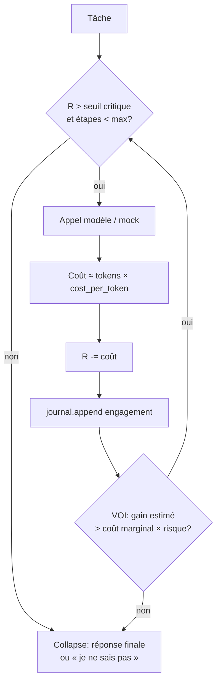

# Démo — boucle IDC

Flux de décision (mock ou LLM). Aucune perf inventée.

## ASCII

```
  ┌─────────────┐
  │   Tâche     │
  └──────┬──────┘
         ▼
  ┌─────────────┐     R > seuil ?     ┌──────────────┐
  │  Délibérer  │────────────────────▶│  Appel modèle│
  │  (étape n)  │     oui             │  + coût ≈tok │
  └─────────────┘                     └──────┬───────┘
         ▲                                   │
         │                    R -= coût      │
         │                    journal.append │
         │                                   ▼
         │                            ┌─────────────┐
         │         gain > coût×risque │  VOI / stop │
         └────────────────────────────│  rule       │
                     oui              └──────┬──────┘
                                             │ non / R bas
                                             ▼
                                      ┌─────────────┐
                                      │  Collapse   │
                                      │  réponse ou │
                                      │  « je ne    │
                                      │    sais »   │
                                      └─────────────┘
```

## Mermaid



## Lancer

```bash
PYTHONPATH=python python3 examples/01_support_client/run_mock.py
PYTHONPATH=python python3 examples/04_langgraph/run_mock.py
```

Voir aussi [PERFORMANCE.md](../PERFORMANCE.md) (chiffres mock uniquement).
